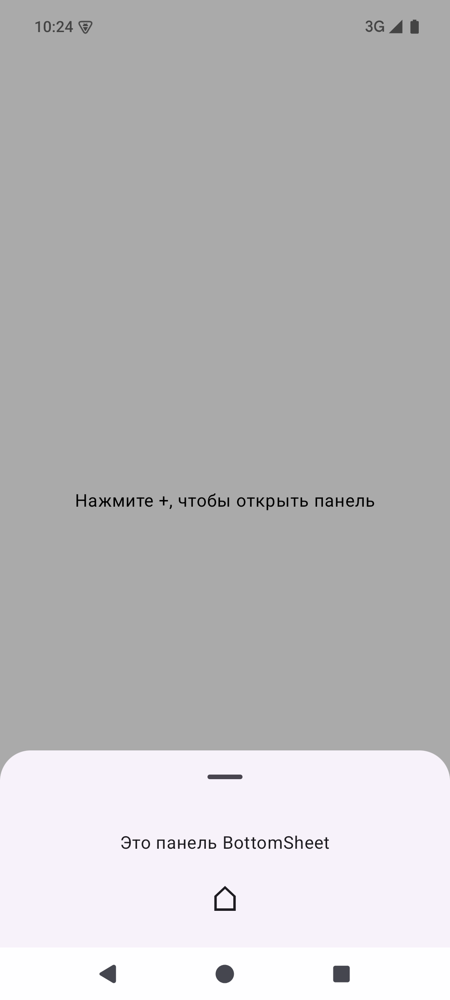
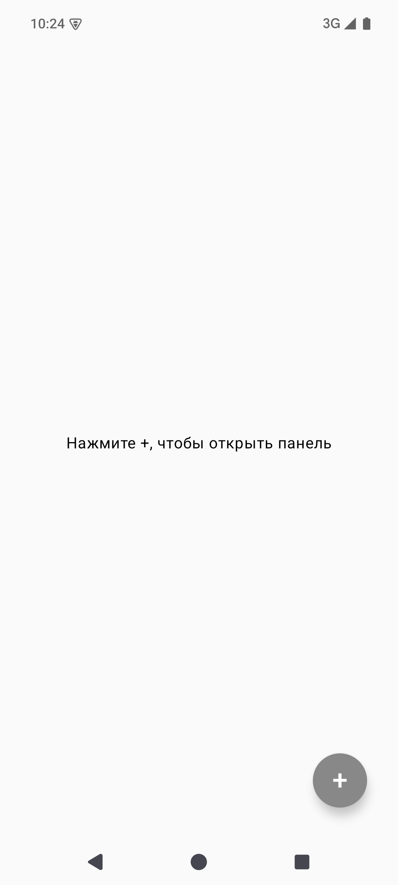

# Compose: FloatingActionButton и ModalBottomSheet

Отдельный учебный проект для [практического задания спринта 7 Яндекс Практикума](https://practicum.yandex.ru/learn/ap-android-st/courses/21155f86-1ed1-40ba-b811-22c80f4802c0/sprints/1093787/topics/5a5020f2-ee6f-441c-b2bb-5cfdcbb3f872/lessons/c204a402-1653-41c4-9f79-14e557401f1e/).

На экране размещена круглая `FloatingActionButton`. Нажатие на неё открывает `ModalBottomSheet`; нажатие вне панели или свайп вниз закрывает её через `onDismissRequest`.

## Проверка

1. Откройте проект в Android Studio и дождитесь синхронизации Gradle.
2. Запустите конфигурацию `app` на эмуляторе или устройстве.
3. Нажмите `+` в правом нижнем углу, затем нажмите вне панели.

Сборка из терминала: `./gradlew :app:assembleDebug`.

## Скриншоты

Скриншоты сняты с эмулятора Android API 35 после установки и запуска `app-debug.apk`.

| Экран с кнопкой | Открытая панель | Панель закрыта нажатием на фон |
| --- | --- | --- |
|  |  |  |

Проверено: `./gradlew :app:assembleDebug --offline` завершился успешно; приложение запустилось на эмуляторе, нажатие `+` открыло панель, нажатие вне панели её закрыло.
